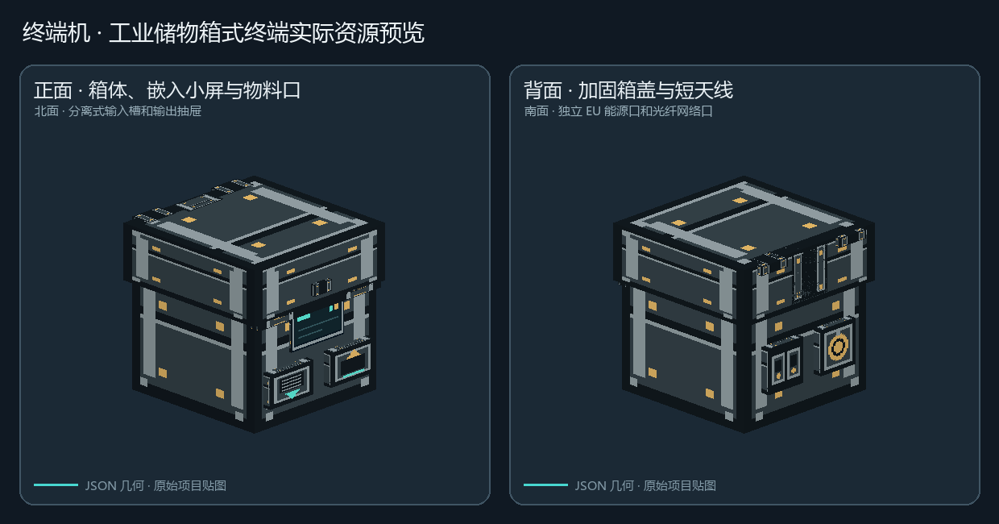

# 手机点歌、充电与箱式终端交付（2026-10-18）

## 后续原生迁移：当前入口

用户随后要求将点歌和机器人对话迁入 Mod、不经 QQ，并将独立语音启动门槛改为 3.5 GiB。原生 Java 媒体包已构建安装；实际公开 MP3 完整静音播放通过。用户同意 EULA 后，隔离专服已两次到达 Done，八角色生成、重载及重启回读通过。原 LLM 配置未改。当前实现、安装哈希、语音进度与实机边界统一见 [原生迁移交付](native-media-migration-2026-10-18.md)。下文 8012、未重载、未接受 EULA 及旧构建回执是迁移前记录，不作为当前操作要求。十小时旧播放器循环的最终结果仍保留在本页。

## 迁移前交付状态（历史）

本次已实现手机音乐界面、共享服务端媒体桥、个人歌单、箱式终端外观、中后期手机配方、四档充电宝与机器人 24/6 小时耗电调整。构建、安装与包审计的最终回执见文末。原 ChatRobot 的 LLM 配置没有改动。

**手机音乐尚未完成原 AstrBot 进程重载和游戏端到端验收。** 新桥接代码已写入 QQ 项目，但当前管理面板保存凭据返回 401，没有可用的已登录会话；已请求用户正常登录后重载“聊天机器人 / astrbot_plugin_qqchat”。不重置密码、不绕过登录，也不替换原 LLM。隔离专服文件已经准备好，EULA 未接受，服务端和世界未启动。此前八角色语音样本验收属于旧直连传输阶段，不能充当本次新网络路径的实机验收。

## 手机怎么用

手机制造改为电子材料加工机的六槽路线，完整配方仍由 ProcessGraph 生成：

| 原料 | 数量 |
| --- | ---: |
| 机器人控制核心 | 1 |
| 工业 SSD | 2 |
| GPU | 1 |
| IC2 UESC（`ic2:uesc`） | 1 |
| IC2 复杂电路（`ic2:complex_circuit`） | 2 |
| 高级充电宝 | 1 |

加工 2400 tick、256 EU/t；20 TPS 下为两分钟、614,400 EU。储能原料会作为制造材料消耗，已有电量不转移给成品，建议用放空的材料。科技检索展示该工业路线，不新增成就门禁。手机自身仍为 200,000 EU、IC2 等级 1。

1. 给手机充电，手持右键进入设备页，在有管理权限的交换机 Wi-Fi 覆盖内打开“手机音乐”。
2. 输入歌名、歌手或自然语言要求后点“点歌”。服务器把你的歌单与真实搜索候选交给已有 LLM；有有效推荐时自动准备并播放，也可在“搜索结果”手动选择。
3. 将公开歌单链接、逐行歌名或 JSON 歌单复制到剪贴板，点击“粘贴导入歌单”。**导入会替换当前个人歌单**，按原顺序去重，最多 100 首；搜索结果可逐首收藏、歌单可移除单首。
4. 使用上一首、下一首、暂停/继续、停止/取消。暂停保留播放位置；播放完一首自动继续队列。关闭手机界面可以继续听；离开服务器会停止并清理传输。

本版接入网易云公开搜索、公开歌单和可匿名取得的完整音源。会员、付费、仅试听、已下架或地区不可用曲目会明确失败；没有替换为试听片段，也没有会员破解接口。歌单只保存编号、歌名、歌手，按玩家 UUID 保存在服务器玩家数据中，不保存音源 URL。逐行歌名在播放前仍需解析为真实曲目。

读歌单消耗手机 20 EU；搜索、导入、收藏操作、开始一首歌各消耗 100 EU。自动下一首需要背包中仍有带电手机且能连上有权限的 Wi-Fi。当前已下载的曲目离开 Wi-Fi 后可继续播放；再次准备新曲目时重新检查。音量实时跟随游戏“主音量 × 音乐音量”，歌曲播放/暂停期间停止原版随机背景音乐。声音只给点歌玩家播放，不向全服广播。

剪贴板上限为 16,384 字符，同时受 Minecraft 上行数据包的实际 UTF-8 字节预算限制。超长中文歌单在本机提示缩小导入内容；长中文聊天自动保留能装入包的最近历史和最后问题，防止合法操作因超过原版 32,767 字节上限而断开连接。

## 机器人与充电宝

- 机器人电池为 4,000,000 EU、IC2 等级 3，恢复真实充电等级校验；低等级机器不会给高等级电池/充电宝充电。
- 初级/中级/高级/核能充电宝对应等级 1/2/3/4，容量 4/8/16/32 百万 EU。它们均是有限储能；核能版使用既有有限核燃料补电，满电暂停，不是无穷电源。
- 玩家副手放充电宝时，按手机、机器人电池、其他兼容 IC2 装备顺序补电；普通背包内只自动补手机。充电宝不会互充。
- 机器人九格货物区也支持放充电宝，自动给装着的电池补电；由于电池等级 3，需高级或核能充电宝。核能燃料在活着的已加载机器人内也会按规则运转。
- 满电在 20 TPS、实体加载、无额外操作消耗的情况下，待命/普通跟随约 **24 小时**，持续工作或追击攻击约 **6 小时**。开着杀戮开关但无目标时按待命耗电；没有可工作的目标时也不会凭模式白白按四倍消耗。聊天与远程机器人命令仍另收 2000/200 EU。
- 分数 EU 的余量写入实体与收回娃娃 NBT。机器人未加载、离线或已收回时不模拟离线耗电；低 TPS 会延长现实时间。死亡寿命、五次上限及电池清空沿用此前实现。

核能充电宝改为深色壳体、绿色核标识与发光层；名字和耐久/能量条保留，未恢复冗长物品描述。资源预览：


## 箱式终端与界面

终端主体改为带箱盖、金属包角和正面抽屉的工业箱，屏幕缩为嵌入式小面板，背面保留 EU/光纤接口。实际模型由 12 个 cuboid 构成，保持在一个标准方块内；原有 144 格分页面板和工业网络功能保持。没有改 IC2/Create 的设备外观。



各 GUI 的按钮、菜单槽位、快捷移动、请求编号与服务端校验已逐项静态审阅。修复机器人主手拖放规则和快捷装备规则不一致、未知手机动作先扣电的问题。手机音乐界面按逻辑视口布局并分页。终端/工业设备 GUI 本身仍为固定尺寸，极小逻辑视口的裁切属于待实机确认项。详见 [GUI 审阅记录](gui-audit-2026-10-18.md)。

## 多人和服务器部署方式

```text
玩家手机 / 机器人对话
  → 已认证的 Minecraft 连接
  → 游戏服务器校验玩家 UUID、所有权、距离、Wi-Fi、电量
  → 服务器主机 127.0.0.1:8012 上的 ChatRobot 插件
  → 原有 LLM / 公开歌曲来源 / 可选 TTS 与 RVC
  → Minecraft 音频分块，仅发回请求玩家
```

单人游戏中，“服务器主机”就是运行游戏的电脑；独立专服中，是运行 Forge 服务端的电脑。远程玩家不用安装 Python/TTS，手机也不填写 IP、端口或密钥。专服需要同时部署 QQ 项目的 ChatRobot 桥及其原有运行依赖；把它留在房主另一台电脑的 localhost 不会自动连通。模型配置在桥服务端管理。

内网穿透按同一 Minecraft TCP 连接传输文字、歌单与音频，只需转发实际游戏端口（默认 25565），8012 保持 loopback。代码不要求客户端能访问服务器私网地址。**目前尚未用两个真实玩家或公网隧道连接验证。** 安装文件和操作步骤见 [专服部署记录](dedicated-server-2026-10-18.md)。客户端和服务端必须使用本次一致的新纪元 JAR：机器人通道版本 3，新增媒体通道版本 1。

服务端线程不等待 HTTP/模型：四个后台工作线程、八个等待任务、每玩家最多两个请求；同类型任务不重复排队。歌曲上限 12 分钟/16 MiB，语音上限 90 秒/8 MiB；Minecraft 每次发送 32 KiB 音频并等待该玩家下一次请求，校验序号、长度和 SHA-256。服务器临时音频预算 128 MiB，桥歌曲缓存 256 MiB/6 小时、同时转码最多两个。超时、取消、退出和关服均释放任务及临时文件；解码按小块执行，避免把整首歌解压进内存。

机器人聊天和语音也经过同一服务端通道。语音只对应刚取得的本人机器人回复，有效期五分钟，每条回复一次尝试；新聊天取消未完成的旧语音。失败保留完整文字，目前没有同一条回复的重试按钮。八角色模型与原 LLM 配置沿用原项目。

## 已验证的范围与证据

| 检查 | 结果与限制 |
| --- | --- |
| QQ 后端接口 | 13 项本地接口检查通过；真实 HTTP/ffmpeg/缓存/Range/并发/取消，LLM 和部分平台响应使用明确标记的夹具。不能代替原 AstrBot LLM 端到端调用。 |
| 公开音乐来源 | 实际取得《Pretty》完整 314.247 秒 OGG，3,713,427 字节；实际公开热歌榜 200 首按 100 首上限截断。不可公开取得的曲目返回 409。 |
| 客户端播放器 | 29 项静音实跑断言通过，使用 Windows 默认真实 Java Sound 输出线路；OGG/WAV、暂停续播、快速取消、替换与文件清理通过。音量为零，不能据此声称已听到声音。 |
| 网络编解码 | 使用真实生产类、Forge/Minecraft FriendlyByteBuf、Netty/Gson，核对 JSON/NBT、12 条历史、16,384 字符、60,000 字符响应、32 KiB 分块与非法边界；没有替身 Forge。 |
| 配方与包 | 543 份 JSON/mcmeta 可解析，无重复 ZIP 路径；手机路线与生成配方一致，ProcessGraph 保持 244 条路线。 |
| 专服 | 官方 Forge 43.5.0 安装器校验与依赖准备成功，七个服务端模组；未接受 EULA、未启动服务端、未建世界。 |

证据目录：

- 本项目 `build-isolated/media-audio-check-20261018/`：29 项短检查、日志、声音设备和临时资源清理证据。
- 本项目 `build-isolated/media-protocol-check-20261018/`：实际生产 codec 检查及长中文传输边界补充。
- QQ 项目 `artifacts/minecraft-music-20261018/`：接口检查、公开来源结果与面板重载失败记录。
- QQ 项目实现和启用说明：[MINECRAFT_MUSIC_BRIDGE.md](../../qq-chatrobot-all/qq-chatrobot/docs/MINECRAFT_MUSIC_BRIDGE.md)。

## 十小时检查：已完成

既有 OGG/WAV 播放器组件在 **2026-10-18 00:47:21（北京时间）**开始单 JVM、音量 0 的低负载循环，并于 **10:47:21（北京时间）**完成；配置每十分钟执行一轮短 WAV/OGG 生命周期，JVM 限制为 `-Xmx256m`、`-XX:MaxDirectMemorySize=64m`。结果记录总运行 36,000.002 秒（10 小时），60/60 轮通过、0 失败。

运行 ID 为 `55b99aed54324961bb34cd2b9c1c15a1`，PID 为 35396，Java 路径为 `C:\Program Files\Microsoft\jdk-17.0.20.101-hotspot\bin\java.exe`；helper 命令行记录了该 Java、SoakRunner 与唯一 runId，helper、progress、result 的 runId 一致。完成后核对 PID 35396 已不存在，未操作该进程或其他 Java/Minecraft 进程。逐样本 JVM 指标范围及结束值：heap used 2,097,152–41,731,296 字节，末值 18,591,888；direct buffer 0–5,612,080 字节、buffer 数 0–342，末值 565,808 字节、34 个；线程 7–10，末值 10。它们是 JVM 指标，不是系统 RSS。stderr 为空。

证据位于 `build-isolated/media-audio-check-20261018/soak-55b99aed54324961bb34cd2b9c1c15a1/`，最终核查回执位于 `build-isolated/native-media-migration-20261018/soak-final-readonly-audit.json`。这是迁移前 OGG/WAV 播放器编译类的独立静音 JVM 生命周期检查，不代表连续播放十小时，不覆盖新 MP3、原生模型或独立语音，也不等于 Minecraft GUI、可闻效果或多人实机验收。
## 迁移前构建与安装回执（历史）

最终构建 28 秒成功；JAR 1,702,180 字节，SHA-256 `6066C28B77F862883F95E3C0CC7FE3CA1141E4C4DE5C94932EE408EB45D7D7AC`。PCL 安装于 `2026-10-18T00:58:22.7852954+08:00` 完成，只替换新纪元一个 JAR；专服于 00:58:36 同步相同版本。

最终构建日志：`build-isolated/phone-music-20261018-build-final.log`。包审计：`build-isolated/phone-music-20261018-package-audit.json`。实际 PCL 安装时间、位置与八个模组哈希以 `build/deployment/pcl-installation.json` 为准；专服目录中的 `server-preparation-audit.json` 保存服务端七个 JAR 的校验值。最终汇总在 `build-isolated/phone-music-20261018-delivery.json`。

这次没有启动、关闭或强杀 Minecraft，没有修改玩家存档，没有上传 GitHub或发布。剩余实机验收包括：全部 GUI 缩放/拖放、电子机实际合成、IC2 不同等级充放电、机器人 24/6 小时和死亡收回持久化、八角色新传输路径的可闻语音、音乐与 LLM 原服务联调、两名玩家的权限隔离/重连/重启、真实公网或内网穿透。
