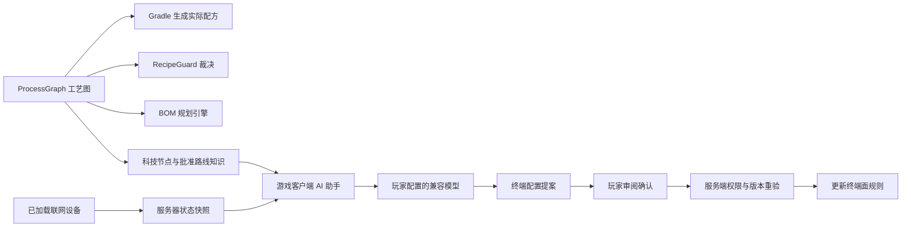

# IC2：新纪元——开发进度、技术流程与简历参考

整理日期：2026-10-13。以当前源码、活动规范、构建日志、实际安装回执及阶段文档为依据；最近一次功能交付是2026-10-12。本文整理已经采用的设计依据、实现步骤和技术取舍，便于写简历与准备面试。本次没有修改游戏源码、重新构建、安装或运行游戏。

**项目定位**

基于 Minecraft 1.19.2 / Forge 43.5.0 / Java 17 开发的工业模组扩展，整合 IC2 Classic 2.1.3.4 与 Create 0.5.1.i 的既有能力，实现统一矿物工艺管理、电子材料制造、工业数据网络、设备诊断、仓储终端与受确认的 AI 配置提案。

职责边界：IC2承担EU电网和已有工业加工；Create承担转速、机械加工、水洗和既有物流；新纪元承担工艺规则、必要材料、数据与控制。电动机是已实现的单向EU到Create转轴动力设备，电网与机械网络仍独立，工业网络只传数据。化学体系已退出范围。

项目采用个人需求驱动与AI辅助开发方式。职责可按实际参与写为“负责需求定义、工业路线规则和迭代验收要求，组织AI辅助实现，推进跨模组集成与交付核对”。下方技术成果描述的是项目实际实现；面试时应能说明所选条目的数据结构、调用过程、校验和局限。

**目前完成到哪一步**

| 模块 | 当前实现 | 验证层级 |
| --- | --- | --- |
| 新矿与受控粉末 | 新增镍/铬/钛/钨4种矿；受控材料合计14种，含14条水洗路线；普通粉优先复用原模组 | 源码、构建、安装；实际生成/加工待验收 |
| 统一工艺数据 | 236条路线：179条批准工业、57条单倍旧路线；12条合金炉路线 | 图、生成配方及JAR静态核对完成 |
| 配方裁决 | 区分旧路线、批准工业与旁路；精确检查类型、输入、数量和输出，保留原矿单倍直烧 | 源码、构建；JEI与原生机器运行待验收 |
| 材料与电子链 | 高低碳钢粉/锭、6种新增合金；硅、高纯硅、PCB、集成电路、CPU、RAM、GPU、工业SSD | 已实现并随包安装 |
| 材料处理机 | 非金属处理机、电子材料加工机，共2台，接入IC2 EU并提供槽位/JEI说明 | 已实现并随包安装；实机待验收 |
| 生产规划 | 按批准路线递归展开整数BOM、批次数、设备和已知EU消耗；识别循环并限制规模 | 引擎和服务端方法已实现；当前服务器GUI为概览/设备列表，不把规划页或整厂执行视为已启用 |
| 工业数据网络 | 自动邻机识别、最近有权限网络、光纤优先/WiFi、有界拓扑发现、加载区块检查 | 源码、构建、安装；多人拓扑待验收 |
| 服务器诊断与权限 | 同一设备名单用于页面、统计、操作和AI；三档配置权限及目标身份重验 | 源码、构建、安装；多人权限待验收 |
| 仓储终端 | 144槽、四页GUI、六面模式、白名单、留存与搬运速率；相邻公开库存接口 | 源码、构建、安装；实际物流待验收 |
| EU电动机 | 32/64/128 RPM，EU输入接入Create轴网，启停/反转/红石/外源优先 | 源码、构建、安装；实际动力负载待验收 |
| 游戏内AI助手 | 兼容Chat Completions、异步HTTP、流式输出、超时/取消、资料检索与工厂快照 | 接口层已实现；真实模型请求和回答效果待验收 |
| AI控制提案 | 模型输出终端单面规则提案；玩家确认；服务端重验权限、网络、实体、版本、时效及单次票据 | 源码、构建、安装；端到端执行待验收 |
| 科技与界面 | 科技节点/依赖/进度、中文名称与槽位提示、屏幕缩放适配；完整科研解锁门禁仍待完善 | 已实现部分随包安装 |
| 模型与资源 | 7种设备独立立体造型、13种自有锭、22种粉末图标；Python可重复生成及资源索引 | 模型/贴图/比例静态核对；游戏显示待验收 |
| 工程交付 | 固定依赖、离线Gradle构建、资源核对、SHA-256清单、PCL安装与旧包备份 | 最新JAR与已安装JAR哈希一致 |

截至本次整理，源工艺图与JAR中的图相同。最近交付JAR为812028字节，含481个JSON与2个mcmeta，安装回执时间为2026-10-12T09:41:12.5174163+08:00。最近交付脚本核对8个依赖模组的哈希，本次再次只读核对新纪元发布JAR与安装JAR一致。按项目约定未新增或运行测试，因此不能把静态核对、构建和安装写成“完整自动化测试通过”或“全部游戏功能已验收”。

**主要涉及的Java技术**

| 技术 | 在项目中的实际用途 | 可说明的工程问题 |
| --- | --- | --- |
| Java 17、面向对象、接口与record | 机器实体、受控设备接口、工艺/路线/计划/快照数据模型 | 通过共同接口接入受支持设备，隔离第三方API与业务规则 |
| 事件驱动与生命周期 | Forge事件、服务端tick、方块实体加载/移除、数据包重载 | 何时注册/注销能源和库存能力，何时重建索引、同步状态 |
| JSON/Gson与数据驱动 | 工艺图、配方参数、AI快照/提案、生成资源 | 单一数据来源、字段校验、已注册物品与合法数量检查 |
| 图与递归算法 | BOM递归展开、前置节点计算、交换机/光纤队列遍历 | 循环检测、深度/步数上限、整数向上取整、访问集合 |
| 集合与索引 | Map/Set、设备索引、去重、网络连通分量与设备身份表 | 控制发现范围，避免重复扫描和以旧目标身份执行操作 |
| 客户端/服务端通信 | SimpleChannel、FriendlyByteBuf、请求/响应与服务端主线程调度 | 客户端提交意图，服务端校验并修改世界状态；协议版本与消息大小边界 |
| HTTP与异步编程 | Java HttpClient、CompletableFuture、ExecutorService、流式响应读取 | 网络等待不阻塞游戏界面；超时、取消和流关闭如何传递 |
| 参数与权限校验 | 所有者UUID/队伍/管理员、服务器三档配置模式、物品/方向/数量范围 | 页面可查看不等于有执行权限，终端库存ACL独立 |
| 过期与重放防护 | 单次票据、1800游戏tick期限、实体身份与设置revision核对 | 旧快照、设备重放、网络改变和多人修改配置后的提案拒绝 |
| 持久化与序列化 | NBT、玩家Capability、方块实体库存/规则、服务器权限SavedData | 状态随世界保存，客户端显示与服务端权威状态分离 |
| 错误处理与诊断 | HTTP/配置/限流等请求错误提示、旁路配方原因记录、机器状态报告 | 明确未知状态，区分待机、暂停、运行与真正故障 |
| 构建工具与脚本 | Gradle/ForgeGradle、Python、PowerShell、Git | 固定依赖、生成资源、保留回执、核对产物与安装路径 |

这些是Java事件驱动、算法、接口适配和游戏客户端/服务端开发的具体经历。项目没有高并发吞吐、响应时间或性能提升百分比的测量数据，简历量化宜使用已核实的材料/路线/槽位规模。

**主要涉及的游戏开发技术**

1. **Forge内容注册与资源组织。** 用DeferredRegister/RegistryObject注册Item、Block、MenuType、BlockEntity与RecipeSerializer；维护中英文语言、掉落、Tag、模型、贴图及矿物世界生成数据。已有矿只在新生成区块出现，不自动改旧存档。
2. **方块实体与机器运行。** 以服务端tick处理EU缓冲、配方进度、输入/输出状态、暂停/恢复；状态由菜单数据和网络消息同步，客户端负责显示。
3. **Capability与库存接口。** 以ItemStackHandler保存终端库存，用分方向IItemHandler包装暴露六面规则；通过模拟提取/插入与实际搬运处理接收能力及余料。Capability失效/重建与实体生命周期配套。
4. **跨模组API适配。** 通过IC2能源接口接入EU，用Create GeneratingKineticBlockEntity接入轴系动力；读取原生公开活动、储能、进度、转速与过载信号。原生机器未公开的控制或故障原因保持只读/未知。
5. **数据包配方与JEI。** 自定义处理机配方序列化，工艺图生成Minecraft/Create/IC2格式配方，提供JEI分类及输入槽提示。合金统一复用IC2合金炉。
6. **GUI与玩家交互。** Screen/AbstractContainerScreen、Menu/ContainerData、PoseStack、分页、滚动、按钮状态、中文悬停、裁剪及窗口尺寸适配；144槽库存分四页展示。
7. **数据网络与设备发现。** 世界内交换机/光纤图遍历，只访问已加载区块；默认邻机自动识别和最近网络连接，面板状态、操作与AI读同一设备名单。
8. **NBT与多人权限。** 玩家进度、库存、规则与控制权限保存；使用Owner UUID、队伍与管理员/服主模式，消息处理再次校验权限、距离与实体状态。
9. **像素美术与模型。** 原创16×16贴图、方块JSON几何、blockstate朝向、原版物品显示比例、Python/Pillow生成器与实际资源预览。设备保持单方块范围，锭沿用原版铁锭轮廓与显示变换。

**完整开发流程及每一步的依据**

1. **明确范围与依赖职责。** 先整理工业加工、电子与控制需求，再删除复杂化学与重复机器方向。明确两台材料处理机上限，以及游戏工业网络只传数据。这样后续新增物品和设备都有必要性依据。
2. **核实目标版本能力。** 固定Minecraft/Forge/Java/IC2/Create版本，对照实际注册表、JAR资源、公开API与现有配方。示例设备名不能直接当可用ID；钻石有普通粉所以复用，未有粉的矿物不扩展。
3. **建模材料阶段。** 用RAW、IMPURE_DUST、CLEAN_DUST、FINAL_METAL表达金属流程；非金属可不含成锭阶段。显式记录矿石变体和固体打粉输入，区分原矿、旧Create碎矿、成品回收，防止同一资源重复增产。
4. **建立工艺图与生成链。** 在ProcessGraph记录输入/数量/输出/设备/类型/分类/优先级等事实，Gradle从图生成实际配方，运行时重载和同步同一份数据。规则、配方、科技、规划与AI因此能使用共同依据。
5. **接入配方裁决。** 检查当前RecipeManager及已支持IC2机器配方表，精确拒绝未批准阶段转换。保留单倍原矿直烧、成品同级回收及普通粉用途；记录配方ID、输入、输出、原因和动作，避免误删所有矿物配方。
6. **实现加工与规划。** 注册必要材料、实现两台EU处理机、输入校验/输出保护/JEI；BOM引擎按批准路线优先级递归计算整批需求、设备和已知能耗。它提供确定规则下的展开，不是全局最优产线求解器；未知原生耗能不编造。
7. **实现有界数据网络。** 维护加载实体索引和网络连接；队列遍历光纤、查找交换机及联网设备，设置32交换机/256光纤段/128网卡等发现上限。先解决状态的真实来源，再提供界面统计和操作。
8. **实现仓储与本地控制。** 终端提供144槽与六面规则，复用相邻Forge物品接口和既有物流。服务器插入AI核心、开启控制与终端托管后，按本地保存规则搬运；不配置模型也可使用这些本地能力。
9. **加入受控AI。** 客户端异步获取资料与授权快照，向玩家配置的兼容模型发送有限上下文。模型输出建议或终端单面规则提案，玩家审阅后由服务端验证并执行；模型不直接调用机器修改方法，密钥不发送到游戏服务器。
10. **修订玩家体验与资源。** 按实际反馈调整中文提示、按钮、窗口缩放、槽位布局与终端分页；设备造型分别设计，所有锭校准原版显示比例，粉末遵循同一形状与可辨颜色。
11. **阶段构建与可追溯安装。** 检查额度与操作边界，清理前保留回执/备份，固定依赖离线构建，解析包内资源与配方、核对图和指南，记录SHA-256；目标实例关闭后用安装脚本替换并核对。
12. **记录验收并迭代。** 把设计、源码、构建、安装和实机验收分别记录。已经历钢坯改粉末、合金炉统一、设备造型与已有矿物水洗扩展；之后仍须根据游戏实测补齐权限、配方、物流和模型API验收。

数据链可以这样解释：

**迭代过程中的代表性取舍**

| 问题 | 采用的方案 | 技术价值 |
| --- | --- | --- |
| IC2/Create/原版同资源路线不一致 | 共用图并生成配方，裁决受控旁路 | 数据驱动与跨系统一致性 |
| 新工艺影响早期玩法 | 保留单倍旧路线，仅精确阻止未批准跳跃 | 兼容性、业务分类和回归边界 |
| 普通矿粉重复注册 | 洗后复用现有粉，无粉的材料不扩展 | 注册表与Tag兼容，减少内容冗余 |
| 铁粉/煤粉也用于合金 | 清洗阶段与正常粉下游用途分开判断 | 领域阶段与业务规则的正确边界 |
| 无界网络扫描影响游戏世界 | 索引、访问集合、数量上限与加载区块检查 | 算法边界和生命周期管理 |
| 多人配置变化后仍有旧AI建议 | revision、实体身份、单次票据、期限重验 | 过期请求和重放防护 |
| AI查询可能误触发控制 | 状态采集和控制执行分开 | 读写职责分离 |
| 网络请求导致界面等待 | 异步请求、流式正文、取消与超时 | Java异步编程和交互体验 |
| 游戏界面/素材难以维护 | 坐标与菜单约束、生成脚本、资源索引和预览 | 工具化与可重复制作 |

**可直接改写到简历的版本**

项目名称：IC2：新纪元——基于Forge的工业工艺与AI辅助控制模组

项目类型：个人项目 / AI辅助开发。开发时间可按实际经历填写2026.10—至今。

技术栈：Java 17、Minecraft Forge、IC2 Classic、Create、Gradle/ForgeGradle、Gson/JSON、Java HttpClient、CompletableFuture、Forge Capability/NBT、Python/Pillow、PowerShell、Git。

项目简介：面向Minecraft工业玩法开发Java模组扩展，复用IC2电气设备与Create机械加工能力，构建统一工艺图、配方裁决、材料规划、工业数据网络、144槽仓储终端与受确认的AI配置提案流程。

- 建立JSON驱动的统一工艺模型，管理14种受控材料、236条加工路线，并由Gradle生成实际配方，供规则校验、BOM引擎、科技节点与AI工艺知识共用。
- 实现分类配方裁决与整数BOM递归展开，精确检查受控加工阶段、输入数量和设备类型，加入循环/规模校验，保留原矿单倍直烧与成品同级回收。
- 基于Forge方块实体、事件和Capability实现两台EU处理机、144槽终端及六面物品接口，集成IC2能源与Create动力API，完成自定义配方序列化、JEI和中文GUI。
- 实现有界工业网络发现与客户端/服务端状态同步，采用UUID/队伍及三档配置权限，操作前复查目标实体、加载状态和网络关系，使设备页面与AI快照使用同一名单。
- 基于Java HttpClient与CompletableFuture实现兼容模型的异步流式交互、超时/取消及资料上下文组装；终端提案通过玩家确认、服务端版本校验、期限和单次票据后应用。
- 编写资源生成、包核对及安装脚本，完成固定版本离线构建、模型/语言/配方静态核对、SHA-256锁定与旧包备份，交付并安装开发版本。

投Java/通用软件岗位时，优先保留统一数据模型、算法、异步接口、服务端校验和工程交付条目。投游戏Java岗位时，增加Forge注册/生命周期、方块实体、Capability、C/S同步、GUI及跨模组兼容细节。简历空间有限时选4—5条，不必把每种材料都罗列。

**面试时可以讲清楚的四个核心过程**

1. **一次矿物流程调整怎么贯穿系统？** 修改统一图中的阶段/输入/输出，生成配方；图重载并同步；规则、规划、科技与AI使用同一图。必要时替换旧独立配方，核对旧路线保留与数量守恒，再构建安装。
2. **BOM为什么用整数批次？** 输入游戏物品不可取小数，所需批次为向上取整的“需求量÷单批产量”；递归计算输入并记录剩余可能。按优先级选批准路线，使用当前递归路径识别循环和限制深度/规模。
3. **AI建议为什么不能立刻执行？** 模型只能提出约束内规则；用户确认时可能权限、拓扑、实体或配置已变化，因此服务端再次验证。票据限时且消费一次，版本不匹配则要求重新获取快照。
4. **怎样证明交付的是当前代码？** 以源码/图、构建日志、JAR资源、SHA-256清单、安装回执为证据，分别说明编译、内容和安装状态；实际玩法需要玩家/多人实测，不能从构建成功推出全部运行成功。

**尚未完成或不能写为完成的内容**

全厂库存盘点与整厂自动排产执行、所有IC2/Create/第三方机器的可写控制、所有隐藏配方/EMC转换的全面裁决、完整科研解锁门禁、真实模型接口与多人端到端验收仍待完善或确认。人形机器人与ChatRobot连接只曾讨论可行性，没有实现。本项目没有训练大模型、向量数据库或全局优化算法的实现证据。

现有公开仓库和分享包有2026-10-08交付记录；10月10日与12日的后续改动目前仍在本地工作区，最新玩家ZIP未重新导出。本文没有进行提交、推送或发布。

**核对入口**

- [当前开发状态](C:/Users/罗斌/Desktop/IC2-newera/docs/development-status.md)
- [最新矿物水洗交付](C:/Users/罗斌/Desktop/IC2-newera/docs/existing-mineral-washing-2026-10-12.md)
- [服务器设备与诊断交付](C:/Users/罗斌/Desktop/IC2-newera/docs/server-device-list-delivery-2026-10-08.md)
- [终端交付](C:/Users/罗斌/Desktop/IC2-newera/docs/terminal-stage-delivery.md)
- [AI接口与功能说明](C:/Users/罗斌/Desktop/IC2-newera/docs/ai-assistant-setup.md)
- [统一工艺图](C:/Users/罗斌/Desktop/IC2-newera/src/main/resources/data/ic2newera/process_graph/main.json)
- [BOM算法](C:/Users/罗斌/Desktop/IC2-newera/src/main/java/com/ic2newera/process/ProductionPlanner.java)
- [提案重验与票据](C:/Users/罗斌/Desktop/IC2-newera/src/main/java/com/ic2newera/industrial/FactoryAiService.java)
- [异步模型客户端](C:/Users/罗斌/Desktop/IC2-newera/src/main/java/com/ic2newera/integration/llm/LLMChatClient.java)
- [最新安装回执](C:/Users/罗斌/Desktop/IC2-newera/build/deployment/pcl-installation.json)
